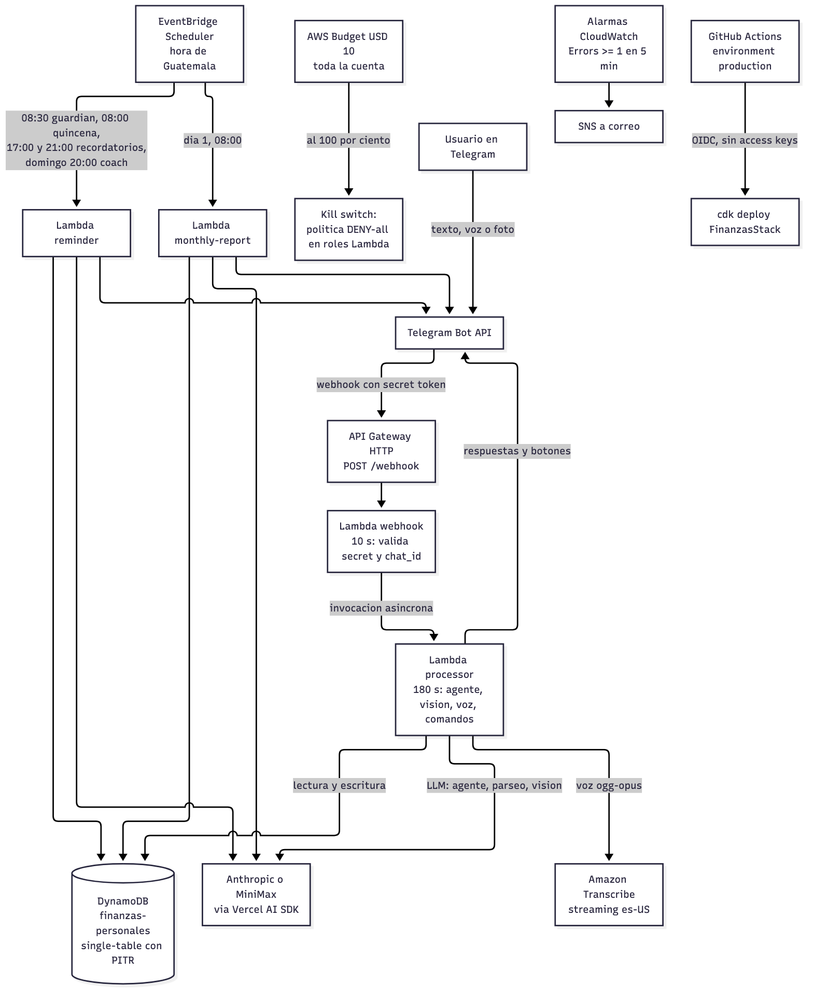
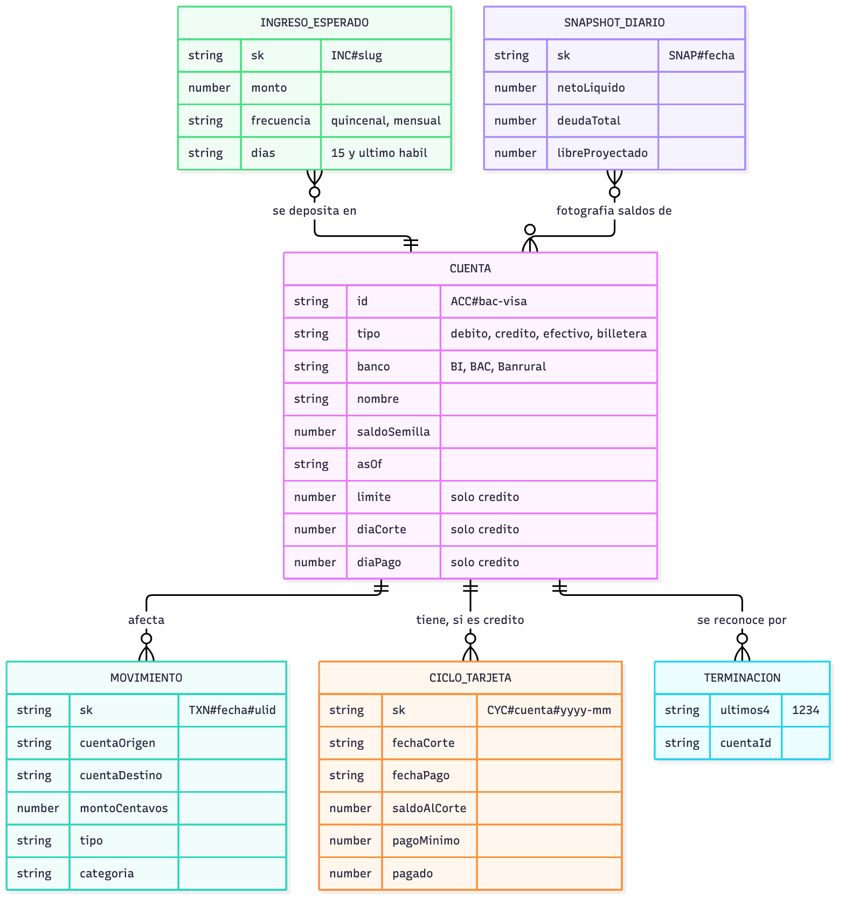
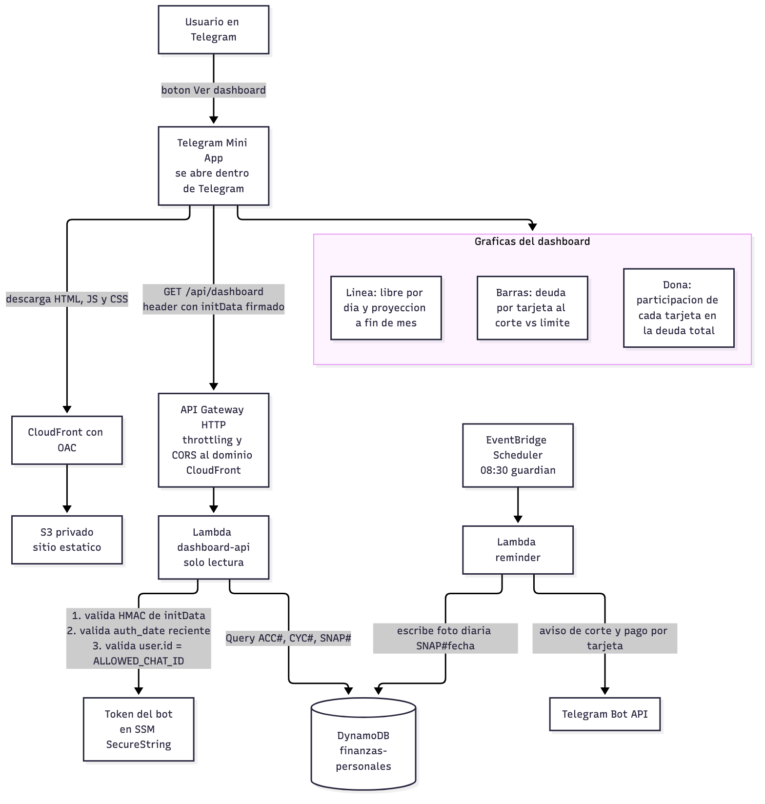
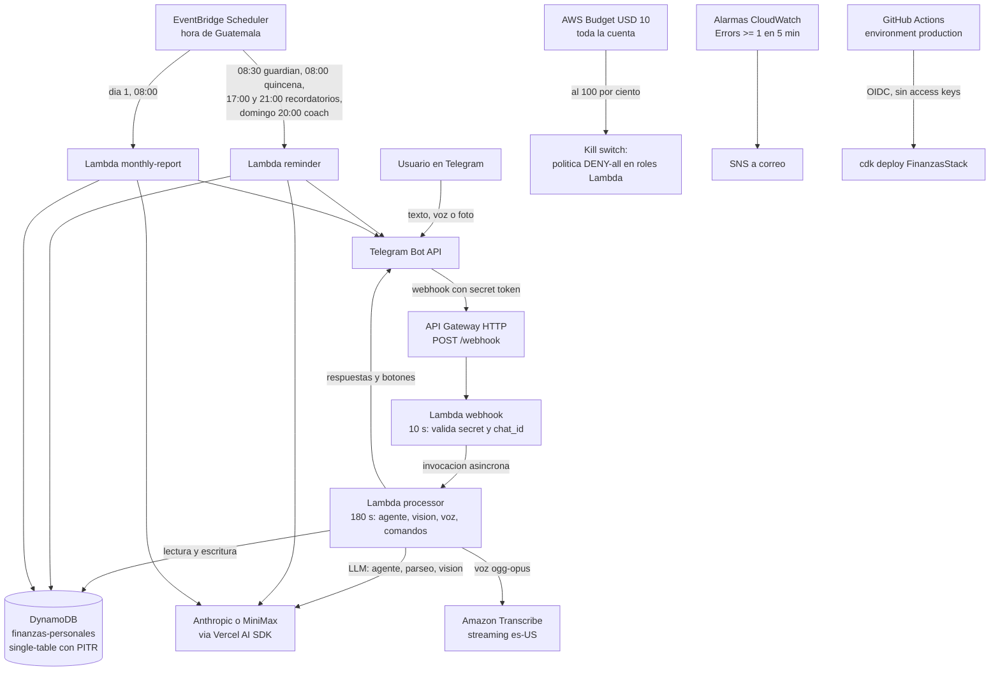
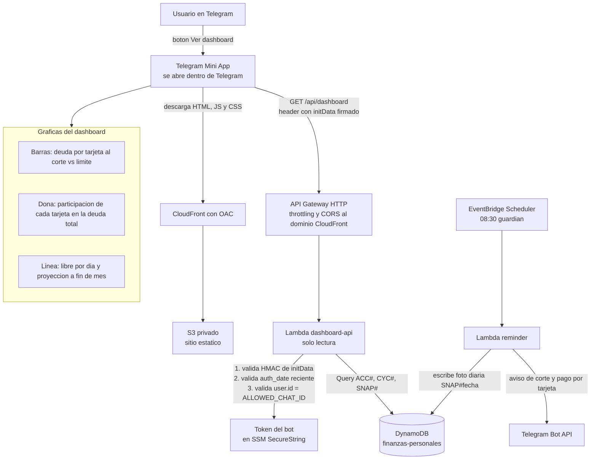
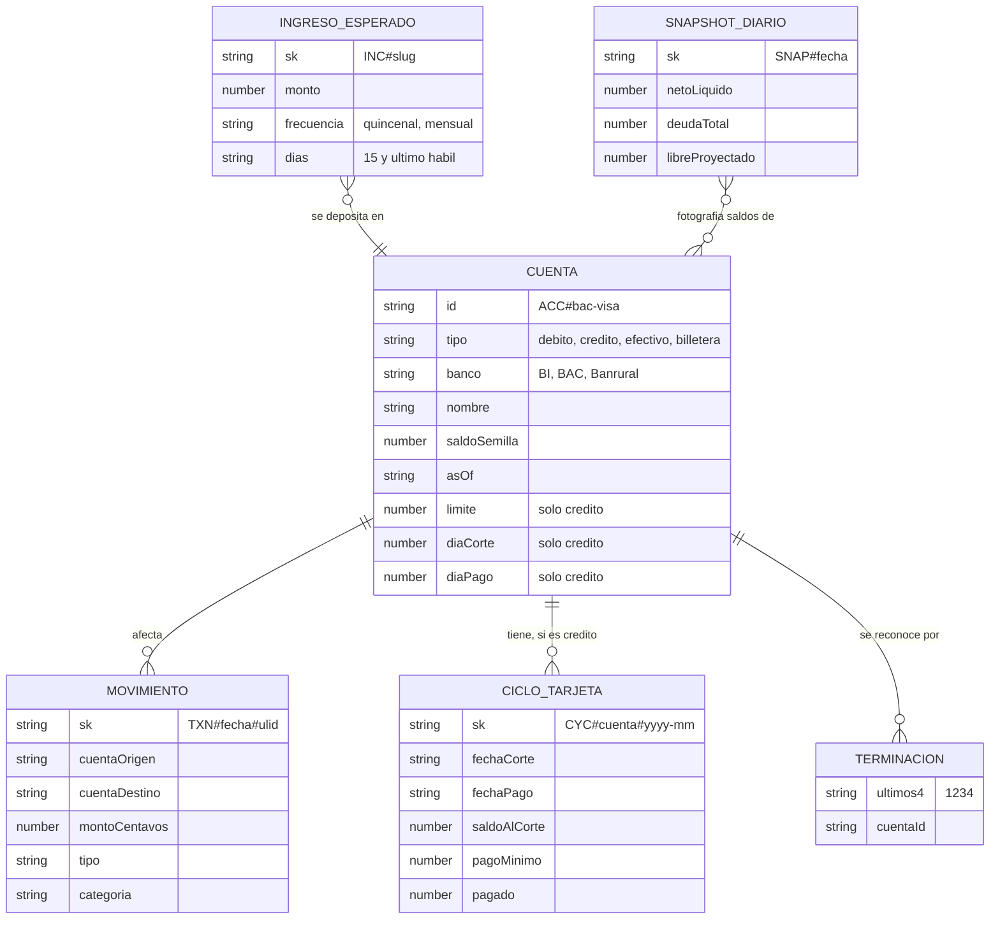

# ANÁLISIS DEL PROYECTO BOT-FINANCE

| Dato | Valor |
|---|---|
| Fecha del análisis | 2026-11-21 |
| Repositorio | `github.com/Allan-Sanchez/bot-finance` (clon local en `~/Developer/bot-finance`) |
| Commit analizado | `b3d9e07` (rama `main`, árbol limpio) |
| Alcance | Revisión de código, infraestructura (CDK), CI/CD y funcionalidad, en modo solo lectura |
| Lo que NO se verificó | No se ejecutaron typecheck, tests ni synth (no hay `node_modules` y no se autorizó instalar). No se revisó el estado real de la cuenta AWS ni del environment de GitHub. `prompts.ts`, `insights.ts` (en parte) y `eval-agent.ts` se revisaron solo parcialmente. |

---

## 1. RESUMEN EJECUTIVO

`bot-finance` (nombre interno `finanzas-web`) es un **bot de Telegram de finanzas personales para un único usuario** (Allan Sánchez, Guatemala, quetzales). No es un producto ni un negocio. No tiene usuarios múltiples, cobros ni onboarding. Se le escribe, se le manda una nota de voz o la foto de un comprobante; un LLM estructura los movimientos y el código calcula saldos, proyección, metas y consejos.

- **Calidad general:** alta para un proyecto personal. La arquitectura serverless es correcta, los números se calculan en código (no en el LLM) y el código documenta con disciplina los incidentes reales que corrigió.
- **Riesgos principales:** los secretos quedan en texto plano en CloudFormation y en la configuración de Lambda, y los logs con datos financieros no tienen retención.
- **Límite funcional principal:** el modelo de cuentas está fijo en el código (BI, Banrural, una sola tarjeta BAC, efectivo, Kash) y el calendario de pago también (el 15 y el último día del mes). No soporta varias tarjetas de crédito, fechas de corte ni terminaciones.

---

## 2. DE QUÉ TRATA EL PROYECTO

### 2.1 Funcionalidad

- **Registro con poca fricción:** texto, voz (Amazon Transcribe en streaming) y foto de comprobante (visión del LLM). Acepta fechas pasadas ("ayer", "el 5 de julio"), hasta un año atrás. Convierte USD a GTQ en código (tipo de cambio `USD_GTQ_RATE`, por defecto 7.80).
- **Modelo de saldos:** saldo base (semilla con fecha `asOf`) más los movimientos posteriores. La función `accountDelta()` aplica las reglas por tipo y método de pago.
- **Agente conversacional con herramientas:** registra, consulta, corrige, elimina, ajusta cuentas, fija metas, marca recurrentes como pagados, busca en el historial y recuerda hechos permanentes (`/memoria`).
- **Asesoría proactiva** (EventBridge Scheduler, hora de Guatemala):
  - 08:30 guardián diario (solo habla si hay hallazgos);
  - 08:00 plan de quincena (solo la víspera de un pago real);
  - 17:00 recordatorio y 21:00 seguimiento si no respondiste;
  - domingo 20:00 resumen semanal con coach;
  - día 1 a las 08:00 reporte mensual.
- **Comandos:** `/hoy`, `/semana`, `/mes`, `/reporte`, `/saldo`, `/proyeccion`, `/metas`, `/recurrentes`, `/memoria`, `/categorias`, `/costo`, `/export` (CSV), `/borrar N`, `/nada`, `/ayuda` y "corrige #N …".

### 2.2 Arquitectura actual

Fuente: `diagramas/01-arquitectura-actual.mmd` (también en el Anexo A).

| Componente | Detalle |
|---|---|
| Lenguaje y herramientas | Node.js 24, TypeScript estricto, pnpm, Vitest |
| Infraestructura | AWS CDK v2, región `us-east-1` |
| Cómputo | 4 Lambdas arm64 de 256 MB: `webhook` (10 s), `processor` (180 s), `reminder` (60 s), `monthly-report` (120 s) |
| Datos | DynamoDB single-table `finanzas-personales`, on-demand, PITR de 35 días, `RemovalPolicy.RETAIN` |
| IA | Vercel AI SDK. Anthropic por defecto (Haiku para visión y redacción, Sonnet para el agente); MiniMax intercambiable solo con variables de entorno |
| Voz | Amazon Transcribe streaming (`ogg-opus`, `es-US`), detrás de un puerto intercambiable |
| CI/CD | GitHub Actions → OIDC → `cdk deploy`. Typecheck, tests, synth y eval "golden" del agente (no bloqueante) |
| Control de costos | AWS Budget de USD 10 con kill switch (política DENY-all sobre los roles de las Lambdas) |
| Monitoreo | Una alarma de `Errors` por Lambda → SNS → correo |

### 2.3 Modelo de datos actual (`USER#allan`)

| Item | SK | Contenido |
|---|---|---|
| Movimiento | `TXN#<fecha>#<ulid>` | monto, tipo, categoría, método, descripción, mensaje original, shortId |
| Cuenta | `ACC#<id>` | semilla, `asOf`, si es estimada |
| Categoría | `CAT#<nombre>` | emoji, origen (`seed` o `auto`) |
| Estado del día | `DAY#<fecha>` | reportado, contador de shortIds |
| Recurrente | `REC#<slug>` | tipo, monto típico, día típico, estado |
| Meta | `BUD#<categoria>` | tope mensual |
| Hecho | `FACT#<id>` | texto aprendido |
| Conversación | `CONV#main` | últimos 12 intercambios, TTL de 72 h |
| Deduplicación | `UPDATE#<update_id>` | TTL de 48 h |
| Uso de IA | `USAGE#<yyyy-mm>` | tokens por modelo y función (no documentado en el README) |
| Cooldown | `META#recask` | última pregunta de recurrentes (no documentado en el README) |

### 2.4 Giro de negocio

No hay modelo comercial. Evidencia de que es de un solo usuario:

- `src/lib/dynamo.ts:30`: `const PK = 'USER#allan'`.
- `src/handlers/webhook.ts`: descarta cualquier `chat_id` distinto de `ALLOWED_CHAT_ID`.
- `src/lib/accounts.ts:4`: cuentas fijas de Allan.
- `src/lib/dates.ts:71`: calendario de pago de Allan fijo en el código.
- `lib/finanzas-stack.ts:221`: correo personal del autor como valor por defecto.
- Los prompts y las descripciones de las herramientas nombran a "Allan".

---

## 3. LO QUE ESTÁ BIEN

1. **Webhook delgado y procesamiento asíncrono** (`webhook.ts`, `processing.ts:86-100`). El webhook responde en milisegundos y delega al processor. Si la invocación falla devuelve 500 para que Telegram reintente. La deduplicación por `update_id` vive en el processor con un `ConditionExpression` atómico.
2. **Los números salen del código, no del LLM.** Saldos (`accounts.ts`), proyección (`projection.ts`), metas, conversión USD. El LLM solo redacta. La salida estructurada se obtiene con un tool call obligatorio y se valida con zod.
3. **Defensas contra fallos del modelo:**
   - red de seguridad determinista cuando el agente dice "registrado" sin haber escrito (`processing.ts:449-486`);
   - aviso "no guardé nada" si la afirmación falsa persiste;
   - `enforceStatedMethod`: si el usuario nombra la cuenta, el método no se negocia con el modelo (`guards.ts:52`);
   - avisos de duplicados (con ventana de 30 días para pagos de tarjeta) y de montos grandes.

   Cada regla documenta el incidente real que la originó (14-jul, 31-jul, 3-sep, 1-oct, entre otros).
4. **Operación resistente:**
   - reintentos en Telegram solo ante 5xx, 429 o red;
   - si Telegram rechaza el HTML, se reenvía en texto plano;
   - el indicador "escribiendo…" se mantiene vivo y su intervalo se limpia en `finally`;
   - los errores quedan en la memoria de la conversación;
   - si el coach falla, igual sale un mensaje con los números calculados.
5. **Infraestructura con criterio:** Lambdas arm64, DynamoDB on-demand con PITR y `RETAIN`, alarmas por Lambda, schedules con zona horaria explícita.
6. **CI/CD razonable:** OIDC sin access keys, con un rol que solo puede asumir los roles `cdk-*` y solo desde el environment `production`. `permissions: contents: read` a nivel del workflow, `id-token: write` solo en el job de deploy, `concurrency` sin cancelar despliegues en curso, `--frozen-lockfile`.
7. **Calidad del código:** TypeScript estricto con `noUncheckedIndexedAccess`, 18 archivos de test de lógica pura, proveedor de IA detrás de un único punto (`llm.ts`) y voz detrás de un puerto (`stt/`). Eval "golden" con conversaciones reales.
8. **Fechas bien resueltas** (`dates.ts`): todo pasa por `Intl` con zona explícita (porque `TZ` está reservada en Lambda); las fechas retroactivas se validan con un round-trip.

---

## 4. LO QUE ESTÁ MAL (POR GRAVEDAD)

### 4.1 Gravedad alta

**H1. Secretos en texto plano en CloudFormation y en la configuración de Lambda**

- **Dónde:** `lib/finanzas-stack.ts:42-63`, `:95-99`, `:115-126`.
- **Qué pasa:** `TELEGRAM_BOT_TOKEN`, `ANTHROPIC_API_KEY`, `MINIMAX_API_KEY` y `TELEGRAM_WEBHOOK_SECRET` se inyectan como variables de entorno durante el synth.
- **Consecuencia:** quedan en la plantilla subida al bucket de assets de CDK, en el historial de CloudFormation y en `lambda:GetFunctionConfiguration`. Cualquiera con lectura en la cuenta los ve.
- **Corrección:** SSM Parameter Store SecureString o Secrets Manager, leídos al arrancar y guardados en caché. La Lambda recibe solo el nombre del parámetro y permiso `ssm:GetParameter` sobre él. Valorar si hay que rotar el token del bot y la API key.

**H2. Logs con datos financieros y sin retención**

- **Dónde:** el stack no define `logRetention` ni `logGroup`, así que CloudWatch guarda los logs para siempre.
- **Qué se loguea:** texto del usuario, respuesta del agente, `rawMessage`, hechos aprendidos (`agent.ts:351`, `:367-372`; `processing.ts:466-471`, `:670`; `dynamo.ts:164`). Incluye montos, comercios, salario y deudas.
- **Corrección:** un `logGroup` con `retention` de 1 a 3 meses por función, y loguear identificadores y longitudes en lugar del texto completo.

### 4.2 Gravedad media

**M1. El kill switch no corta lo que de verdad cuesta**

- **Dónde:** `finanzas-stack.ts:243-279`.
- **Qué pasa:** la política DENY-all bloquea las llamadas a AWS que hacen las Lambdas, pero API Gateway y las invocaciones de Lambda se siguen cobrando. El webhook ya no puede invocar al processor, devuelve 500 y Telegram reintenta en bucle; las alarmas mandan un correo cada 5 minutos. Las llamadas a Anthropic y Telegram no pasan por IAM.
- **Agravante:** el budget es de **toda la cuenta**: cualquier otro recurso de la cuenta puede apagar el bot.
- **Corrección:** concurrencia reservada en 0 (budget action → SNS → Lambda que la aplique) o throttle de 0 en el stage. Filtrar el budget con un tag de costo del stack.

**M2. API HTTP sin throttling**

- La URL de `execute-api` es pública. Sin el secret recibe un 401, pero cada petición invoca la Lambda y suma a la factura y a las alarmas.
- **Corrección:** `defaultStage.throttle` de unas 5 rps con burst de 10.

**M3. `corregir_movimiento` acepta montos negativos o en cero**

- **Dónde:** `agent.ts:226` (`monto: z.number().nullable()`) y `processing.ts:384`, que lo escribe tal cual.
- La otra ruta de corrección sí valida `> 0` (`parse.ts:246`), y el registro filtra en `toOutcome`.
- **Consecuencia:** un `-50` del modelo invierte el signo en todos los saldos.
- **Corrección:** `z.number().positive().nullable()` más una validación en `correctMovement`.

**M4. Posible doble registro después del reintento del agente**

- **Dónde:** `agent.ts:349-373`. `usedWriteTool` se calcula solo sobre el resultado del **reintento**.
- **Escenario:** el primer intento llama a `corregir_movimiento` y responde vacío; el reintento no escribe; `usedWriteTool` queda en `false`; si el texto coincide con `REGISTER_INTENT_RE` ("pagué…"), la red de seguridad registra un movimiento nuevo.
- **Corrección:** acumular la detección de escrituras de ambos intentos, como ya se hace con `registered`.

**M5. Un timeout del processor pierde el mensaje sin avisar**

- **Presupuesto:** 90 s del agente + 60 s del reintento + parser de respaldo + transcripción, frente a 180 s de Lambda (`processing.ts:447`, `agent.ts:334`).
- Si Lambda corta por timeout, el `catch` no corre. El `update_id` ya quedó reclamado, así que el reintento asíncrono lo descarta. Solo llega el correo de la alarma.
- **Corrección:** un presupuesto global con `AbortSignal` derivado de `context.getRemainingTimeInMillis()`, aviso al usuario antes del corte y `onFailure`/DLQ en la invocación asíncrona.

**M6. Actions fijadas por tag y no por SHA en un job con secretos**

- **Dónde:** `deploy.yml:19-23`, `:45-50`, `:70`. `pnpm/action-setup@v6` y `aws-actions/configure-aws-credentials@v6` son de terceros y corren con el rol de AWS y todos los secretos.
- **Corrección:** fijar por SHA con un comentario de versión y mantenerlas con Dependabot.

**M7. Las API keys llegan a código no revisado antes del deploy**

- **Dónde:** `deploy.yml:60-68`. El eval recibe las API keys y ejecuta código del repo y sus dependencias. Con `continue-on-error: true`, una regresión del agente se despliega igual.
- No se pudo comprobar desde el código si `production` exige revisores.
- **Corrección:** revisor obligatorio en `production` y, cuando el eval sea estable, volverlo bloqueante.

### 4.3 Gravedad baja

| Hallazgo | Dónde | Corrección |
|---|---|---|
| El menú de Telegram omite `/metas` y `/costo` | `scripts/set-webhook.mjs:58-72` frente a `commands.ts:155` | Importar `BOT_COMMANDS` o generar un JSON compartido |
| Escrituras que pueden pisarse (lectura y luego escritura) | `appendConversation` (`dynamo.ts:186`), límite de `putFact` | `list_append` o condición de versión |
| Dinero como `number` de punto flotante | Varios (`Math.round(x*100)/100`) | Guardar centavos enteros |
| `--require-approval never` en el deploy manual | `package.json:17` | En local, pedir aprobación para ver los cambios de IAM |
| Documentación desactualizada | README (dedupe en el webhook; faltan `USAGE#` y `META#recask`); comentario "3 Lambdas" en `finanzas-stack.ts:217` | Actualizar |
| `retryAttempts: 2` en los schedules | `finanzas-stack.ts:155-210` | Raro, pero puede duplicar un aviso si falla después de enviarlo |
| Comparación del secret con `!==` | `webhook.ts` | `timingSafeEqual`; el riesgo práctico es despreciable |

---

## 5. MEJORAS TÉCNICAS (NO SON DEFECTOS)

1. **Diseño de un solo usuario con valores fijos:** `PK`, cuentas, calendario de pago, nombre en los prompts y correo por defecto. Es el primer refactor si se va a usar para otra persona o como producto.
2. **Reglas de saldos parche a parche:** `accountDelta` es un `switch` de casos especiales que crece con cada incidente. Pasar a **partida doble** (cada movimiento con cuenta origen y cuenta destino) elimina la dependencia de combinar `type`, `method` y `category`.
3. **`processing.ts` concentra demasiado** (1.191 líneas): separar comandos, callbacks y el flujo del agente; hoy esa orquestación no tiene tests.
4. **Observabilidad:** alarma de `Duration` cerca del timeout, métricas propias (activaciones de la red de seguridad, timeouts del LLM), tracing básico.
5. **Datos:** exportación mensual a S3 (más allá de los 35 días de PITR); valorar cifrar con una CMK.
6. **CI:** `pnpm audit` o Dependabot, `cdk diff` informativo, tag de costo en el stack.

---

## 6. ANÁLISIS FUNCIONAL

### 6.1 Resumen

| Pregunta | Estado | Evidencia |
|---|---|---|
| ¿Puedo registrar varias tarjetas de crédito de distintos bancos? | ❌ No | `types.ts:80`: una sola cuenta `tarjeta` |
| ¿Avisa la fecha de corte y de pago de cada tarjeta, con el monto? | ❌ No | No existe concepto de corte ni pago |
| ¿Reconoce la tarjeta por su terminación? | ❌ No | `guards.ts:21-30`: solo nombres de banco |
| ¿Dice cuánto me queda libre? | ✅ Sí | `/saldo`, `/proyeccion`, preguntas libres |
| ¿Avisa si algo se sale del presupuesto? | 🟡 Parcial | Metas por categoría; aviso al día siguiente |
| ¿Dice cuánto queda libre después del salario? | 🟡 Parcial | Plan de quincena y proyección mensual |
| ¿Registra cuándo y cuánto me pagan? | ✅ Sí, con matices | Ingreso registrado; calendario fijo en el código |

### 6.2 Varias tarjetas de crédito: no

- Las cuentas son una lista cerrada: `['banco', 'banrural', 'tarjeta', 'efectivo', 'kash']` (`types.ts:80`).
- Todo pago con `method: 'credito'` resta de la única cuenta `tarjeta` ("Tarjeta BAC", `accounts.ts:61`). Varias tarjetas se sumarían en la misma deuda.
- El agente no puede crear cuentas: `ajustar_cuenta` solo acepta esos cinco IDs (`agent.ts:203`).
- **Riesgo:** `guards.ts:23` fuerza que mencionar "BI" sea **débito** (en el caso de Allan, BI es su débito). Una tarjeta de *crédito* BI se registraría como débito y restaría del banco.

### 6.3 Avisos de corte y pago por tarjeta: no

- No existen fecha de corte, fecha límite, saldo al corte ni pago mínimo.
- Lo más parecido: si el pago de la tarjeta se confirma como **recurrente**, el guardián avisa **3 días después** de la fecha típica si no ve el pago (`insights.ts:218-230`). Es un aviso de atraso, no un recordatorio previo, y usa el monto **promedio histórico**, no el del corte.

### 6.4 Reconocer la tarjeta por la terminación: no

- Solo hay expresiones regulares sobre el nombre del banco ("bi", "bac", "banrural", "kash", "efectivo") en `guards.ts:21-30`.
- La visión lee monto y comercio de un voucher, pero no hay un mapeo terminación → cuenta.

### 6.5 Cuánto queda libre: sí

- `/saldo`: saldo de cada cuenta y neto líquido, con la deuda de la tarjeta restando (`accounts.ts:113-131`).
- `/proyeccion`: neto líquido + ingresos confirmados que faltan − recurrentes pendientes − gasto variable diario × días restantes (`projection.ts:36-77`).
- Preguntas libres ("¿me alcanza para X?"): el agente consulta los mismos datos y da un veredicto.
- **Limitación:** depende de registrar todo y de cuadrar saldos de vez en cuando; hoy toda la deuda de tarjetas cae en una sola cuenta.

### 6.6 Avisos de presupuesto: parcial

- Hay metas mensuales por categoría (`/metas comida 1500`, `/metas sugerir`) con semáforo.
- **No avisa al registrar:** los avisos de registro son de duplicados, montos grandes y movimientos sin cuenta (`guards.ts:115-153`).
- El aviso llega con el guardián de las 08:30, solo si la meta está en rojo y hubo gasto en esa categoría ayer u hoy (`insights.ts:241-250`).
- No hay un presupuesto global mensual. Las metas nunca bloquean (`types.ts:134`).
- **Mejora pequeña:** llamar a `budgetProgress` dentro de `warningsFor` para avisar en el momento.

### 6.7 Libre después del salario: parcial

- **Plan de quincena:** la víspera del pago sugiere cuánto apartar (compromisos pendientes + colchón de unos 14 días) (`insights.ts:173-201`).
- **`/proyeccion`:** incluye el salario confirmado que falta, pero proyecta a **fin de mes**, no a la próxima quincena.
- No calcula "salario + saldo − pagos hasta la próxima quincena = libre" ni descuenta pagos de tarjeta por vencer (no conoce los cortes).
- **Calendario fijo en el código:** el 15 y el último día del mes, retrocediendo al día hábil anterior (`dates.ts:71-106`). Decírselo al bot ("me pagan el 25") solo se guarda como un dato (`FACT#`) y **no cambia el cálculo**.

### 6.8 Fecha y monto del pago: sí, con matices

- "Me cayó el salario, Q7,500" se registra como `ingreso` con fecha y monto. Por defecto entra a BI, salvo que se diga Banrural o efectivo (`accounts.ts:38-40`).
- Tras 2 o 3 meses, el detector lo propone como ingreso recurrente; hasta confirmarlo, la proyección **no** cuenta el salario que falta (conservadora a propósito, `projection.ts:39-43`).
- No permite declarar el salario esperado por adelantado ni distinguir bruto, neto o descuentos.

---

## 7. REDISEÑO PROPUESTO: CUENTAS, TARJETAS E INGRESOS

Fuente: `diagramas/03-modelo-cuentas-propuesto.mmd` (también en el Anexo A).

En orden de dependencia:

1. **Cuentas dinámicas.** Cada cuenta es un registro con `id`, `tipo` (débito, crédito, efectivo, billetera), `banco`, `terminaciones[]` y, si es de crédito, `diaCorte`, `diaPago` y `limite`. Sustituye a `ACCOUNT_IDS` y a las reglas fijas de `guards.ts`. El movimiento guarda la cuenta explícitamente en lugar de inferirla del método.
2. **Reconocer la terminación.** Búsqueda determinista de 4 dígitos en el texto o en lo que leyó la visión, contra `terminaciones[]`; se impone solo si la coincidencia es inequívoca, igual que hoy `enforceStatedMethod`.
3. **Ciclo de cada tarjeta.** Con `diaCorte` y `diaPago`, calcular el consumo del periodo (`CYC#<cuenta>#<yyyy-mm>`) y avisar N días antes del corte y del pago con el monto real del ciclo. Cabe en el guardián de las 08:30.
4. **Calendario de ingresos configurable.** Monto esperado y días de pago como datos (`INC#<slug>`). La proyección pasa a ser por quincena: "libre hasta tu próximo pago".
5. **Avisos de presupuesto al registrar,** y opcionalmente un tope global mensual.

**Consideración de datos:** el punto 1 obliga a migrar los movimientos existentes (no tienen cuenta explícita). Si el bot se usa desde cero para otra persona, eso no aplica.

---

## 8. PROPUESTA NUEVA: DASHBOARD WEB DE DEUDAS Y DISPONIBLE

### 8.1 Objetivo

Ver en la web:

1. cuánto se debe en cada tarjeta de crédito al corte;
2. cuánto representa cada tarjeta del total de la deuda;
3. cuánto va quedando libre a lo largo del tiempo.

### 8.2 Requisitos previos

- **Gráficas 1 y 2:** dependen del rediseño de la sección 7 (cuentas dinámicas con `diaCorte` y `limite`, y ciclos `CYC#`). Con el modelo actual habría una sola barra.
- **Gráfica 3:** requiere guardar una foto diaria (`SNAP#<fecha>` con neto líquido, deuda total y libre proyectado), escrita por el guardián de las 08:30. Hoy el saldo se calcula al momento y no queda historial.

### 8.3 Opciones

| Opción | Cómo funciona | Autenticación y seguridad | Esfuerzo |
|---|---|---|---|
| **A. Telegram Mini App** (recomendada) | Un botón del bot abre una página web dentro de Telegram | Telegram firma los datos de quién la abre (`initData`). El backend valida la firma HMAC con el token del bot, que la fecha `auth_date` sea reciente y que el usuario sea `ALLOWED_CHAT_ID`. No hace falta otro login | Medio: sitio estático en S3 + CloudFront y una Lambda de API de solo lectura |
| B. Web independiente | Sitio propio con login | Requiere Cognito u otro sistema de autenticación; queda una superficie pública con datos financieros | Alto |
| C. Imagen en el chat | `/graficas` responde con un PNG generado en la Lambda | No expone nada nuevo | Bajo, pero estático (sin interacción) |

**Recomendación: opción A.** Reutiliza la autenticación de Telegram, no abre un portal aparte con datos financieros y sigue siendo serverless, con costo de centavos al mes.

### 8.4 Arquitectura propuesta

Fuente: `diagramas/02-arquitectura-propuesta-dashboard.mmd` (también en el Anexo A).

| Componente | Detalle |
|---|---|
| Sitio | S3 privado con CloudFront y Origin Access Control |
| API | API Gateway HTTP `GET /api/dashboard`, throttling bajo y CORS limitado al dominio de CloudFront |
| Lambda `dashboard-api` | Solo lectura sobre `ACC#`, `CYC#`, `SNAP#`. Permiso IAM limitado a `dynamodb:Query`/`GetItem` |
| Secreto | Token del bot en SSM SecureString (alineado con la corrección H1) |
| Datos diarios | El guardián escribe `SNAP#<fecha>` cada mañana |

### 8.5 Gráficas

| Gráfica | Tipo | Datos |
|---|---|---|
| Deuda por tarjeta al corte | Barras horizontales, con el límite como referencia | `CYC#` del último corte por tarjeta |
| Participación en la deuda total | Dona | Deuda actual por tarjeta / deuda total |
| Libre en el tiempo | Línea diaria del mes, con la proyección punteada hasta fin de mes | `SNAP#` del mes + proyección actual |
| Indicadores | Tarjetas de cifra | Deuda total, libre hoy, libre proyectado, próximo corte y próximo pago |

### 8.6 Riesgos y controles

- **Suplantación:** validar siempre la firma HMAC de `initData` en el backend; nunca confiar en datos del cliente.
- **Reutilización del enlace:** rechazar `initData` con `auth_date` vieja (por ejemplo, más de 1 hora).
- **Fuga por caché:** respuestas de la API con `Cache-Control: no-store`; CloudFront solo guarda en caché el sitio estático.
- **Abuso:** throttling en el stage y alarma de 4xx/5xx.
- **Superficie:** API de solo lectura; ninguna escritura desde la web.

---

## 9. PRIORIDAD SUGERIDA

1. **H1 y H2:** secretos a SSM y retención de logs; valorar si hay que rotar credenciales.
2. **M3 y M4:** dos correcciones pequeñas que evitan corromper saldos.
3. **M1 y M2:** kill switch efectivo y throttling.
4. **M6 y M7:** endurecer el pipeline.
5. **Rediseño de cuentas** (sección 7), si el bot va a usarse con varias tarjetas o para otra persona.
6. **Dashboard** (sección 8), que depende del punto 5.

---

## ANEXO A. CÓDIGO FUENTE DE LOS DIAGRAMAS

Los tres diagramas se pueden pegar en draw.io (Arrange > Insert > Mermaid) para obtener formas editables.

### A.1 Arquitectura actual (`diagramas/01-arquitectura-actual.mmd`)

### A.2 Arquitectura propuesta con dashboard (`diagramas/02-arquitectura-propuesta-dashboard.mmd`)

### A.3 Modelo de cuentas propuesto (`diagramas/03-modelo-cuentas-propuesto.mmd`)

